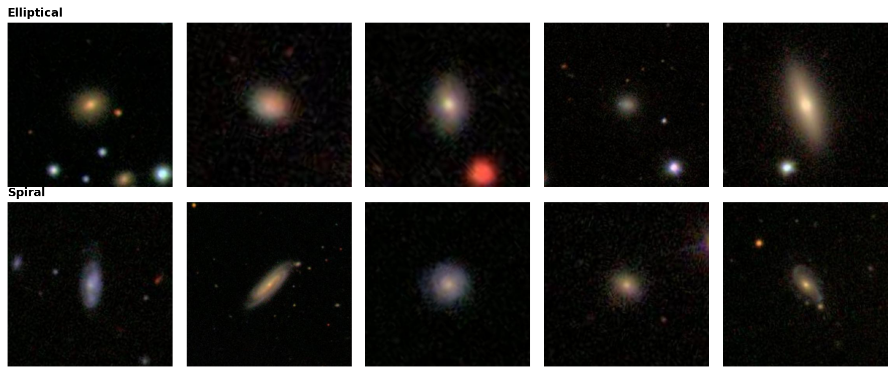
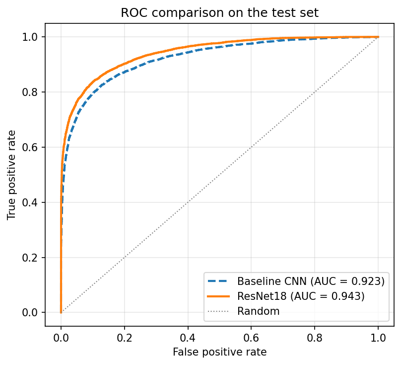
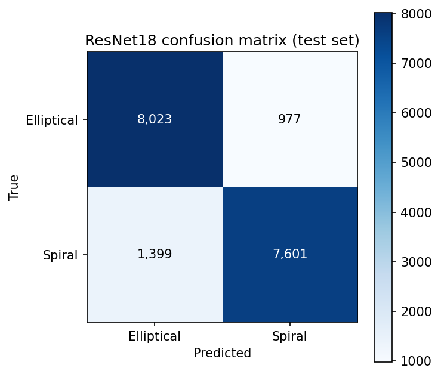
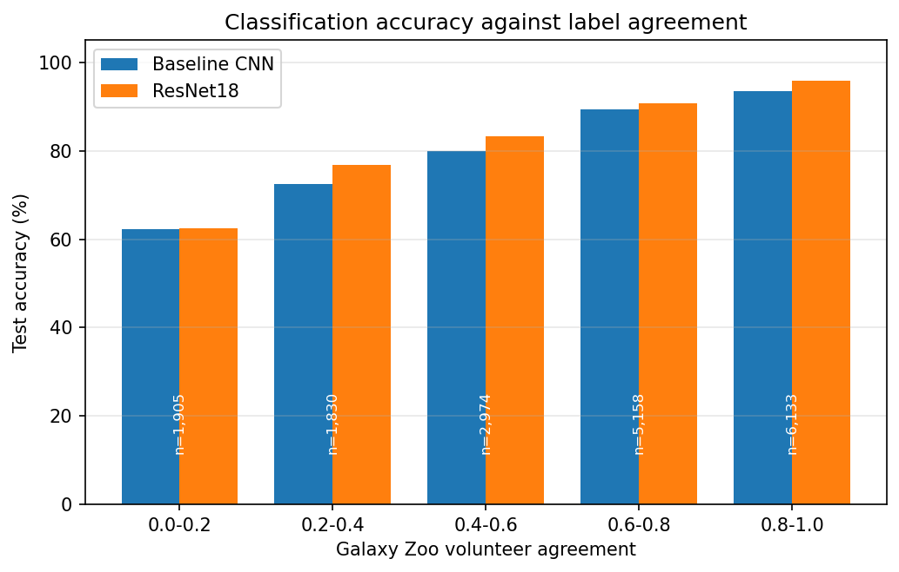
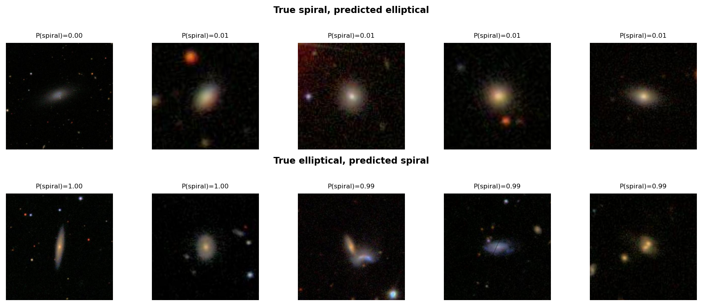

<h1 align="center">🌌 Galaxy Morphology Classification with CNNs</h1>

  <b>Can a neural network tell a spiral galaxy from an elliptical one?</b> 
  My MSc dissertation project at the University of Hull.

  
  
  
  

  

---

## 🏆 Results

| Model | Test accuracy | AUC |
|---|---|---|
| Baseline CNN | 84.6% | 0.923 |
| **ResNet18 (transfer learning)** | **86.8%** | **0.943** |

Transfer learning beat the baseline by 2.2 percentage points.

  
  

---

## 💡 Key findings

- **Humans and the model struggle on the same galaxies.** Accuracy is about 62% on galaxies where labellers disagree. It rises to about 95.8% where they agree.
- **A fair comparison needed a fix.** I found a data normalisation problem and corrected it, so the two models are compared on equal terms.
- **Results match the literature.** I compared them with Barchi et al. (2020) and Dieleman et al. (2015).

  

---

## 🛠️ What I did

1. Used Galaxy Zoo 2 images with the Hart et al. (2016) debiased labels.
2. Built a baseline CNN from scratch.
3. Fine-tuned a pre-trained ResNet18.
4. Trained the models on the University of Hull's Viper HPC cluster.
5. Studied how accuracy changes with label agreement, and looked at the mistakes.

👀 See examples the model got wrong

 

  

---

## 🔒 Code

The code and trained model are private for now.
Available on request: yacine.touatitliba@gmail.com

## 📚 References

- Hart et al. (2016), Galaxy Zoo 2 debiased labels
- Barchi et al. (2020)
- Dieleman et al. (2015)

---

Made by <a href="https://github.com/cicone170">Yacine</a> 🔭
